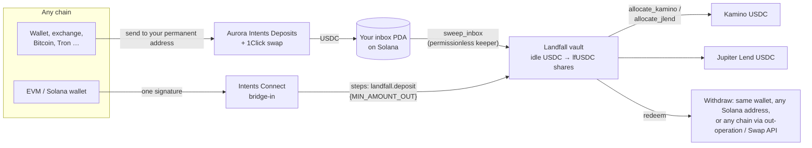

# Landfall

**Deposit addresses that execute on Solana.**

You withdraw 300 USDT from an exchange on Tron to an address you saved months ago. A couple of minutes later it is earning yield in a USDC vault on Solana. You never opened a bridge, never signed a transaction, and never held SOL.

Landfall gives every wallet one permanent deposit address on each of 30+ chains, Bitcoin, Tron and exchange withdrawals included. Whatever arrives is swapped by Aurora Intents, delivered to the owner's inbox on Solana and minted as shares of a curated USDC vault that lends on Kamino and Jupiter Lend. Wallet users can do the same in one signature through Intents Connect. Withdrawals go back out to any chain.

<!-- results:headline -->
A direct bridge-and-deposit into Kamino reverts in 4 of 6 adverse market conditions and strands the bridged funds. Landfall lands 6 of 6.
<!-- /results:headline -->

- **Try it:** open the app, connect any EVM or Solana wallet, and copy your addresses. Or press **Fire a live deposit** on the landing page: a spend-capped wallet on Base sends 1 USDC through Aurora and you watch it land on Solana. No wallet, funds or install needed.
- **Review it in 5 minutes:** [JUDGES.md](JUDGES.md). Every claim and its evidence: [CLAIMS.md](CLAIMS.md). What is real and what is simulated: [MOCKS.md](MOCKS.md).

## Why the landing step matters

The documented way to bring funds into a Solana protocol with Intents Connect is a bridge-in whose steps call the protocol directly, for example a Kamino deposit. The steps run after the user's funds have already crossed chains. If the protocol refuses the deposit at that moment, because the reserve hit its deposit limit, the market went into emergency mode or an upgrade changed an account layout, the bridge-in transaction reverts. Bridge-in steps aren't simulated before signing, the durable nonce is spent, and the USDC sits in the user's intermediary account until someone recovers it by hand.

Landfall splits landing from investing. Landing is one small instruction that only mints vault shares against the idle USDC buffer. It never calls a lending protocol, so it has nothing to fail on. Moving idle USDC into Kamino and Jupiter Lend is a separate, permissionless step that simply waits while a strategy can't take deposits.

<!-- results:landing -->
| Condition (mainnet snapshot, $25 bridged) | Direct deposit into Kamino | Landfall |
|---|---|---|
| Normal conditions (negative control: both must land) | lands | lands, 24.96 lfUSDC minted |
| Kamino USDC reserve is at its deposit limit when the bridged funds arrive | **reverts** (`custom program error: 0x17ca`), $25 stuck | lands, 24.96 lfUSDC minted |
| USDC prints outside the reserve's accepted price band (0.98–1.01), e.g. a depeg wobble | lands | lands, 24.96 lfUSDC minted |
| No fresh Scope price for 10 minutes (reserve max price age is 180 s) | lands | lands, 24.96 lfUSDC minted |
| Kamino main market switches to emergency mode | **reverts** (`custom program error: 0x179a`), $25 stuck | lands, 24.96 lfUSDC minted |
| The USDC reserve is marked obsolete (status ≠ active) | **reverts** (`custom program error: 0x17c2`), $25 stuck | lands, 24.96 lfUSDC minted |
| A protocol upgrade leaves the reserve account unreadable to integrators | **reverts** (`SBF program panicked`), $25 stuck | lands, 24.96 lfUSDC minted |

Adverse conditions: Landfall **6/6**, direct deposit **2/6** ($100 stranded across the failures). Source: `eval/results/landing.json`, produced by `programs/landfall/tests/eval_landing.rs`.
<!-- /results:landing -->

The two "lands" rows for the direct recipe are an honest negative: Kamino deposits don't need a fresh oracle price, so a stale or out-of-band price doesn't break it. The reverts come from hard stops.

## How it works



**Deposit addresses (Intents Deposits).** For each owner the server asks Aurora for one persistent address per chain family, all paying Solana USDC to the owner's inbox account, a PDA of the Landfall program. EVM chains share one address. The keeper opens the inbox (paying its rent) the first time a wallet proves ownership with a signed message, then sweeps any USDC that arrives into the vault and mints the owner's shares. Sweeping is permissionless and the program decides where the shares go, so the keeper can't redirect anything. Addresses can be created confidential (`confidential: true`); they land in the same inbox.

**One-signature deposits (Intents Connect).** A connected wallet gets a quote to Solana USDC with Landfall's bridge-in steps attached: the intermediary deposits `{MIN_AMOUNT_OUT}` into the vault for its owner. EVM, NEAR and Stellar wallets own their shares through their Intents Connect Solana account, which only their own signature controls. A Solana wallet owns its shares directly.

**Withdrawals.**
- Solana wallet → same wallet: one transaction.
- Solana wallet → another chain: a Swap API quote, then one transaction that redeems and pays the quote's deposit address. Refunds go back to the wallet.
- Intents Connect account → any Solana address: a steps-only execution.
- Intents Connect account → any chain: an out-operation that redeems on Solana and bridges out, one signature.

**Recovery.** Every terminal state has a button in the app: sweep an inbox now, finish a stranded bridge-in into the vault from the intermediary's balance (steps-only), or open a support case for a failed persistent deposit.

## The program

Written in Rust with [Pinocchio](https://github.com/anza-xyz/pinocchio) (`no_std`, 102 KB). The wire format matches Anchor (instruction, account and event discriminators, Borsh layouts), so any Anchor client can talk to it. The TypeScript SDK is checked byte for byte against the Rust test client (`packages/sdk/test/vectors.json`).

| Instruction | Who | What |
|---|---|---|
| `deposit` | anyone (wallet or intermediary) | USDC → shares for `owner`, priced at the vault's live NAV. Amount clamps to the balance; 0 is a no-op. |
| `open_inbox`, `sweep_inbox` | anyone | Create an owner's inbox; move its USDC into the vault for that owner, minus a sweep fee capped at 1%. |
| `allocate_kamino`, `allocate_jlend` | anyone | Move idle USDC above the buffer into a strategy, up to its target weight and cap. |
| `redeem`, `redeem_via_kamino`, `redeem_via_jlend` | share owner | Burn shares for USDC from idle, pulling the shortfall from one strategy in the same transaction. |
| `sync_nav` | anyone | Cache the strategies' live values. |
| `init_vault`, `configure_*`, `set_strategy_enabled`, `set_curator` | admin (program upgrade authority) | Set-up; a configured strategy can't be re-pointed. |
| `set_weights`, `set_params`, `set_paused` | curator | Weights and caps, idle buffer, sweep fee (≤1%), minimum sweep (≤5 USDC), pause allocation. |

Safety properties, each covered by a test:
- NAV = idle + Kamino cTokens × (total liquidity / collateral supply) + Jupiter Lend fTokens × exchange price, read from the pinned on-chain accounts in every instruction that prices shares.
- Virtual shares and assets plus dead shares minted at `init_vault` make first-depositor and donation attacks unprofitable; every conversion rounds against the caller.
- If a strategy account becomes unreadable, deposits use its last cached value. If the admin also switches it off, payouts value it at 0 and new deposits wait with the depositor instead of being mispriced.
- The curator can't move user funds, can't stop withdrawals, and can't hold an inbox hostage (minimum sweep is bounded).
- `init_vault` can only be called by the program's upgrade authority, and the share mint can't be pre-funded into a broken state.

<!-- results:compute -->
| Transaction | Compute units |
|---|---|
| deposit | 16,474 |
| create the share account + deposit | 38,153 |
| deposit while both strategies hold funds | 17,428 |
| sweep an inbox (creates the share account) | 46,393 |
| refresh_reserve + allocate into Kamino | 85,856 |
| allocate into Jupiter Lend | 76,567 |
| refresh_reserve + withdraw through Kamino | 76,584 |
| withdraw through Jupiter Lend | 74,006 |

Program binary: 101,984 bytes, sha256 `6c7d94b70f930184097debecc1a43eaebca8d8a0b30ae1907edf3eb5e11a761c`.
<!-- /results:compute -->

## Repository

```
programs/landfall/     Pinocchio program, LiteSVM tests against mainnet account snapshots
packages/sdk/          TypeScript SDK: instruction builders, NAV reader, Intents Connect steps,
                       Aurora Intents clients, keeper logic, curator and set-up scripts
apps/web/              Next.js app: landing, /app (addresses, deposit, withdraw, recovery), /vault
apps/keeper/           Keeper loop: open inboxes, sweep, allocate, sync
eval/results/          Machine-written results that every number in these docs comes from
scripts/               Fixture dump, deploy, results renderer
```

## Run it

Requirements: Node 22+, pnpm 9, Rust with the Solana platform tools (`cargo-build-sbf`).

```sh
pnpm install
pnpm build:program                                   # target/deploy/landfall.so
cargo test --manifest-path programs/landfall/Cargo.toml   # program tests + landing eval
pnpm --filter @landfall/sdk test                     # SDK tests
node scripts/render-results.mjs                      # refresh the numbers in the docs
cp apps/web/.env.example apps/web/.env.local         # then fill it in
pnpm --filter @landfall/web dev
```

| Variable | Purpose |
|---|---|
| `AURORA_API_KEY` | Aurora Intents key (Intents Studio). Server side only; persistent addresses need it approved. |
| `SOLANA_RPC_URL` | Mainnet RPC. The browser talks to it through `/api/solana-rpc`, a method allow-list. |
| `KEEPER_SECRET_KEY`, `KEEPER_PUBLIC_KEY` | Keeper key that pays inbox rent and sweep fees; the public key is shown on `/vault`. |
| `DEMO_ENABLED`, `DEMO_EVM_PRIVATE_KEY`, `DEMO_FIRE_AMOUNT_USDC`, `BASE_RPC_URL` | The "Fire a live deposit" button: a Base wallet holding only the demo budget, one fire per 45 s. |
| `MAX_NEW_INBOXES_PER_HOUR` | Global cap on new inboxes (the keeper pays their rent). |

The keeper runs anywhere Node runs: `KEEPER_SECRET_KEY=… SOLANA_RPC_URL=… pnpm --filter @landfall/keeper start`.

## Honest limits

- Mainnet only. Aurora Intents has no testnet, so the program was proven on LiteSVM against mainnet account snapshots before it went live, and the vault runs with small caps.
- Persistent deposit addresses need an Aurora API key approved for them. Without one, `/api/addresses` reports `pending-approval` and the wallet flow (Intents Connect) still works.
- Failed persistent deposits are retried by Aurora rather than refunded; the app links to the support flow for those.
- Strategy values between instructions come from the last `sync_nav`; every share-pricing instruction reads them live.
- No audit beyond our own review. Don't put more in than you'd be happy to lose.

## License

MIT
